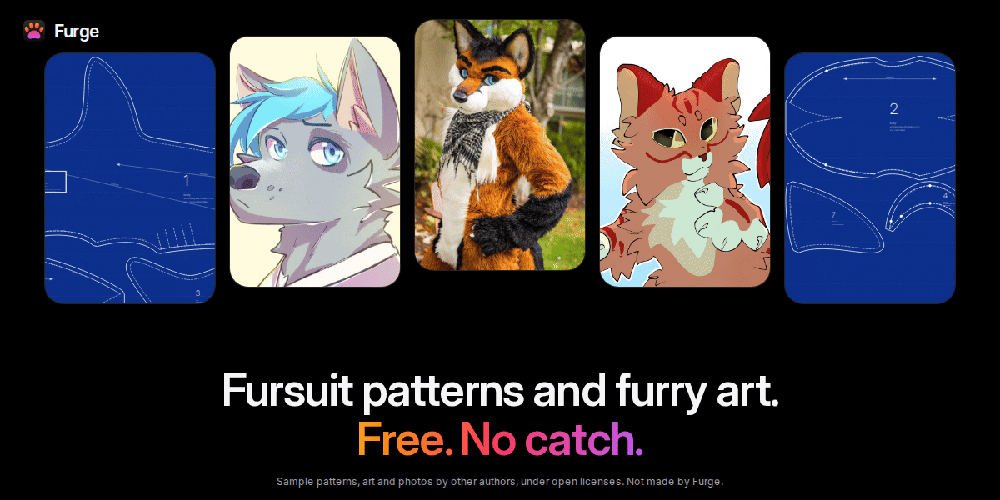
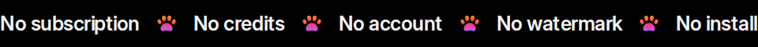
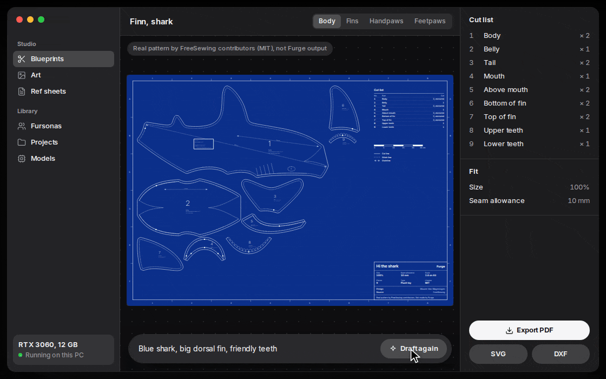
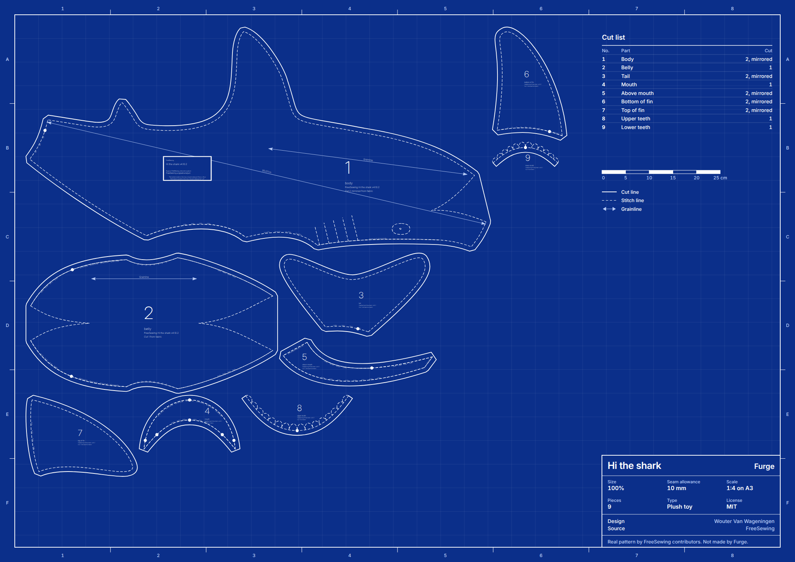
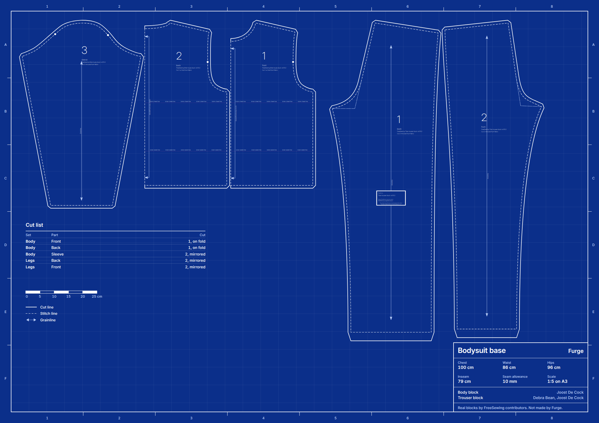
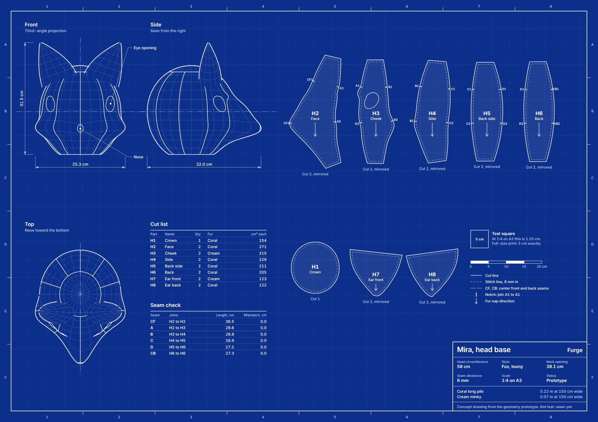
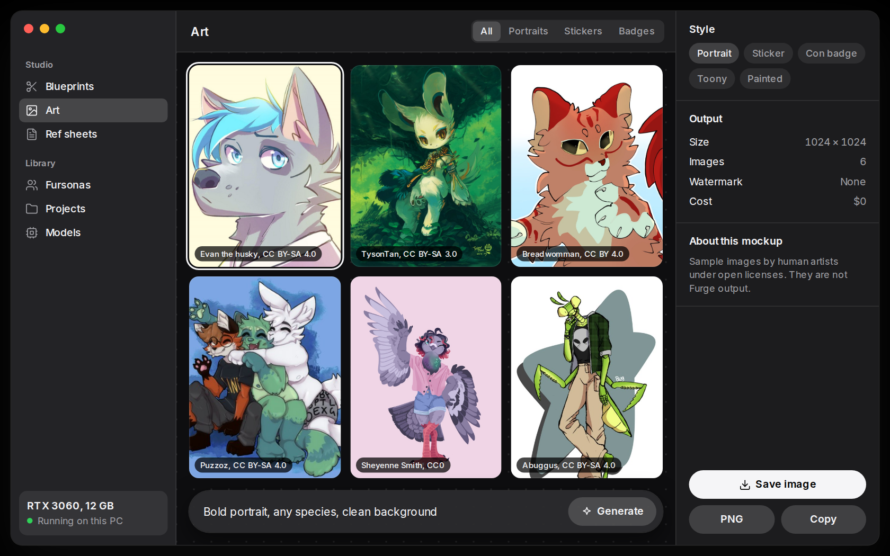
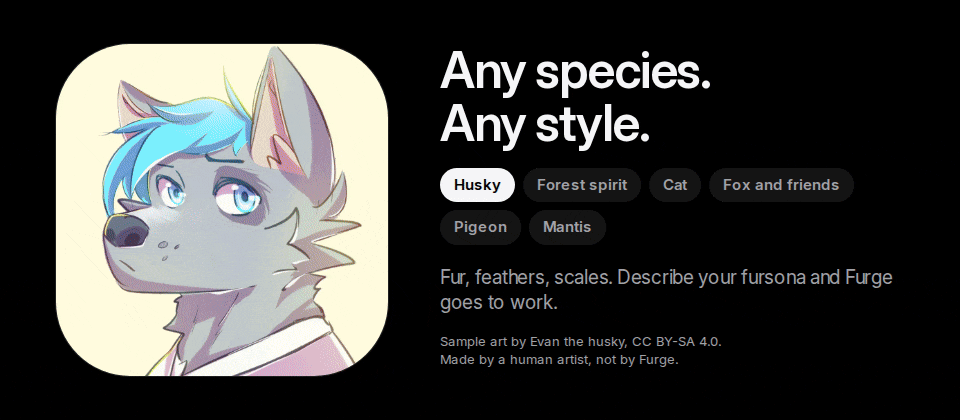
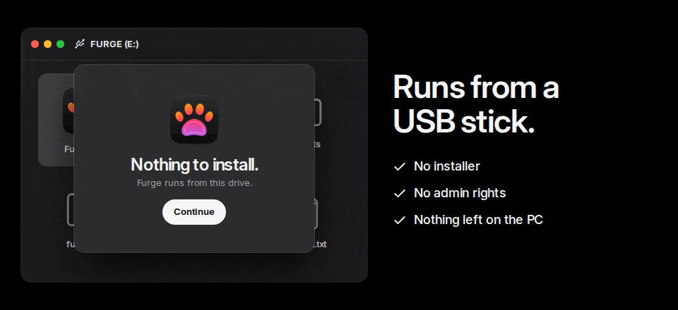

  

  
  
  
  
  

<h1 align="center">Stop paying for patterns.</h1>

<b>Furge is a free AI studio for fursuit blueprints and furry art. One folder. Your GPU. No account, no credits, no bill.</b>

  <a href="#why-furge">Why Furge</a> ·
  <a href="#what-you-get">What you get</a> ·
  <a href="#portable-for-real">Portable</a> ·
  <a href="#how-it-works">How it works</a> ·
  <a href="#faq">FAQ</a> ·
  <a href="#roadmap">Roadmap</a>

  

> [!IMPORTANT]
> **First public build is out.** The portable zip carries `Main.exe`, its update settings and the Furge runtime, so nothing else has to be installed. See [Get it](#get-it).

## Why Furge

Your fursona lives rent-free in your head. Getting it out costs a fortune.

Makers' price lists put full-suit commissions at around **$2,400 and up**, and past **$6,500** for the big builds. That money pays for real skill, and it's worth every cent. But plenty of people want to build their own, and they hit the same wall on day one: **what shape do you even cut?**

So you buy a pattern. You pay for a template that doesn't fit your head. You sign up for an image generator, burn your credits by Tuesday, and get a watermark for the trouble.

**Furge ends that.** Describe your fursona. Get pieces you can print, cut and sew, sized to you, for nothing.

| | The usual way | Furge |
|---|---|---|
| **Price** | Per pattern or per month | **$0. No tiers.** |
| **Account** | Email and password | **None** |
| **Your character** | On their server | **On your drive** |
| **Fit** | One size, good luck | **Your size** |
| **Watermark** | On the free plan | **Never** |
| **Install** | Installer and updater | **Unzip and run** |
| **If the company dies** | So does your stuff | **MIT. Fork it.** |

## What you get

  

Mockup. The sheet is Hi the shark, a real pattern by FreeSewing contributors (MIT), standing in for Furge output.

### Blueprints

Type what you want. Furge drafts it.

- **Head, handpaws, feetpaws, tail and bodysuit** as separate sheets
- **Solid cut lines, dashed stitch lines and nap arrows**, so your fur runs the right way
- **A cut list and a fur estimate**, before you spend a dollar on fabric
- **Sized to you.** Enter your measurements or start from your duct-tape dummy
- **Tiled PDF for A4 and Letter** with a test square, plus SVG and DXF for cutting machines

#### Real sheets, today

  

<b>Hi the shark.</b> A real plush pattern by Wouter Van Wageningen, from FreeSewing (MIT). Print it at true size: <a href="assets/blueprints/freesewing/hi.svg">hi.svg</a>.

  
  

<b>Bodysuit base.</b> FreeSewing's Brian and Titan blocks (MIT), drafted to one set of measurements: <a href="assets/blueprints/freesewing/torso.svg">torso.svg</a>, <a href="assets/blueprints/freesewing/legs.svg">legs.svg</a>. <b>Head base.</b> Our own prototype: a 3D head cut along seams and unfolded, so neighboring seams match in length. Not test-sewn yet.

#### Need paws today?

Makers already share free paw patterns. Get them from the source, and check each page's terms first:

- [Curlworks puffy paws](https://www.curlworks.net/extras/curlworks-free-puffy-paw-pattern-amp-tutorial): free for personal use and commissions, per the page. The author notes it's very old and unsupported.
- [Gatorwave 4-finger handpaw](https://gatorwave.gumroad.com/l/4FingerHandpawPattern)
- [RunnerRabbit handpaw](https://runnerrabbit.gumroad.com/l/XHegGV)

### Art

  

Mockup. Sample images are by human artists, credited on each tile and in <a href="CREDITS.md">CREDITS.md</a>.

Portraits, stickers, con badges and ref sheets, on your own GPU, with no queue, no credits and no watermark.

  

## Portable. For real.

One zip, attached to the latest release. It carries `Main.exe`, its update
settings and the Furge runtime, so nothing else has to be installed:

| System | File |
|---|---|
| Windows 10 and 11 | [`Fursuit.exe`](releases/latest) |

Download and start the exe. No installer, no admin rights.

The build is not code-signed yet, so SmartScreen may warn once: choose **More info**, then **Run anyway**.

  

Furge is one folder. Put it on a USB stick and take your fursonas to the con, your friend's PC or the library. Your projects and models move with it, and nothing stays behind when you unplug.

**Planned requirements:** a GPU with 8 GB of VRAM or more for art. Patterns need far less. Expect about 7 GB of disk for the art model, downloaded once on first launch.

## How it works

Most AI tools would hand you a pretty picture of a pattern, and you can't sew a picture. A generated image has no idea how a curved surface flattens or whether two seams match in length.

So Furge splits the job:

1. **AI reads your description** and picks the shape: species, ears, muzzle, markings and colors.
2. **Geometry does the cutting.** A parametric base scaled to your measurements gets flattened into real pieces, with seams that actually match. Bodies build on FreeSewing's open-source, made-to-measure engine.
3. **You get files.** Print the tiled PDF, check the test square, cut and sew.

The app and the AI step aren't built yet. The geometry has a first prototype in [`design/src/pattern.js`](design/src/pattern.js), and none of this has been through a full fursuit build.

## FAQ

**Is it actually free?**
Yes. Your GPU does the work, so there's no server bill to pass on to you. No tiers, no credits, no "Pro". The code is MIT, so it stays free even if we vanish.

**What's the catch?**
You supply the GPU, and you still have to sew. Furge cuts the pattern bill, not the work.

**Can I use it today?**
Yes — grab the zip from [releases](releases/latest), Download and start `Main.exe`. The FreeSewing sheets in [`assets/blueprints/freesewing`](assets/blueprints/freesewing) are printable on their own.

**Will this replace my favorite maker?**
No. A great suit takes years of skill that no pattern file contains. Furge is for people who want to build their own. If you want a masterpiece, commission a maker and pay them what they ask.

**Can I post Furge art on Fur Affinity?**
No. Fur Affinity bans AI-generated art. Check the rules of any gallery or con before you post or sell, and always label AI art as AI. Don't pass it off as hand-drawn, and don't feed the model someone else's character or style without permission.

**Can I sell suits I build from a Furge pattern?**
That's the plan: what you make is yours, with no royalty and no credit required.

**Does it phone home?**
That's the plan too: no. Patterns work offline from the first launch, and only the model download needs a connection.

## Roadmap

- [x] Brand, icon and interface direction
- [x] Real blueprint sheets from FreeSewing patterns
- [x] Head base flattening prototype
- [ ] Test-sew the head base and fix what's wrong
- [ ] Tiled PDF, SVG and DXF export
- [ ] Portable Windows and Linux builds
- [ ] Local art generation
- [ ] Handpaws, feetpaws, tails and bodysuits
- [ ] Ref sheet builder
- [ ] Import a scanned duct-tape dummy

## Make it real

**Star it** if you're tired of paying for this. **Open an issue** if you've built a suit and know where patterns go wrong: makers' input matters more than anything else here right now.

## License

Furge's code and brand assets are [MIT](LICENSE). Third-party patterns and images keep their own licenses, listed in [CREDITS.md](CREDITS.md). Mockup images that contain CC BY-SA art are shared under CC BY-SA 4.0.

  <picture>
    <source media="(prefers-color-scheme: dark)" srcset="assets/brand/logo-white.svg">
    
  </picture>

